# LLM Arena

<p align="center">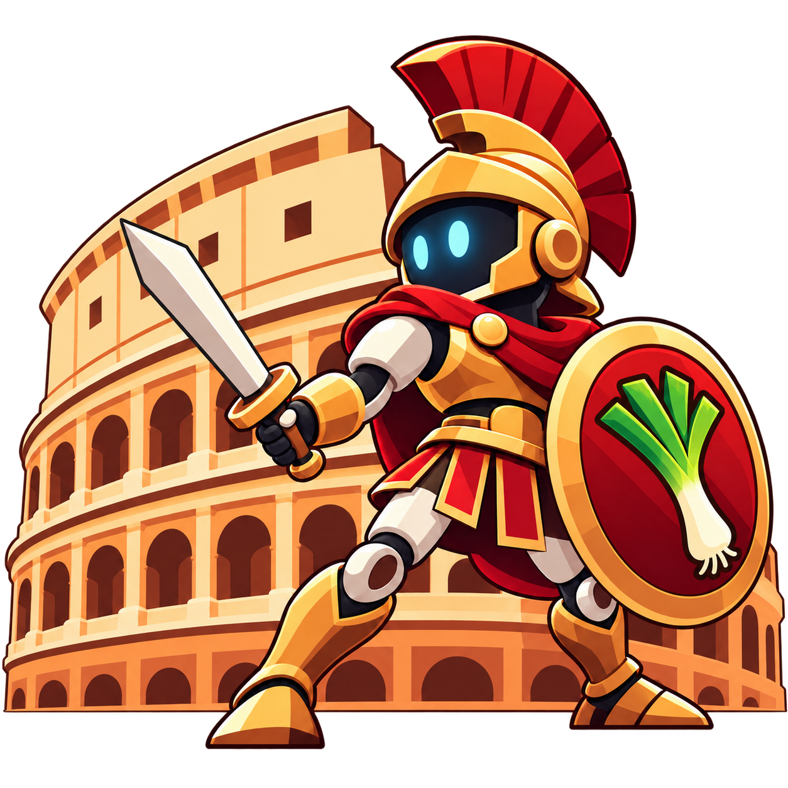</p>

**LLM Arena is a benchmark in which language models write combat AIs and then
make them fight.** Each model receives the same documentation and tools, writes
a strategy in **LeekScript 4** (the language of the
[Leek Wars](https://leekwars.com) programming game), tests it against the real
game engine, submits it, and then meets the other models' strategies in a
tournament. Every prompt, tool call, source version, token and fight is recorded,
so you can see *what* each model produced and *how* it got there.

<p align="center">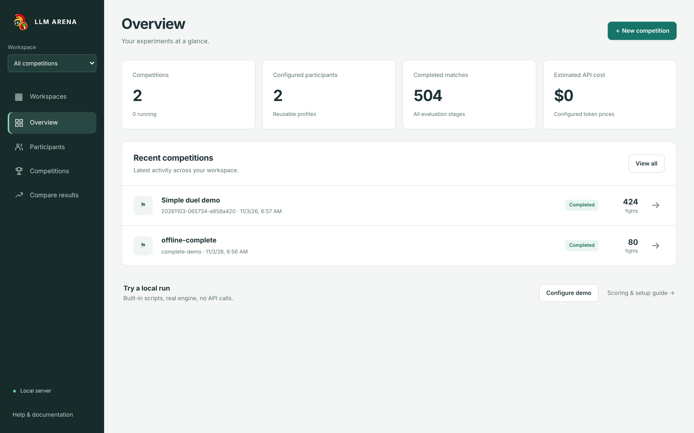</p>

## Contents

- [Why this benchmark?](#why-this-benchmark)
- [How it works](#how-it-works)
- [Interface tour](#interface-tour)
- [Install and first run](#install-and-first-run)
- [Command line](#command-line)
- [Technical reference](#technical-reference)
- [Documentation](#documentation)

## Why this benchmark?

Most coding benchmarks check whether a function passes unit tests. LLM Arena
asks a broader question: **can a model learn an unfamiliar language from
documentation, build a working program in it, debug it against a real system,
and improve it from its results, within a measured budget?**

Leek Wars is a good test bed for this:

| Property | Why it matters |
|---|---|
| **Niche language** | LeekScript 4 is rarely seen in training data. Models have to read the supplied documentation instead of reciting memorized code. |
| **Objective outcome** | A fight ends in a win, a draw or a loss. No human or LLM judge is needed. |
| **Real engine** | Fights run on the official open-source Leek Wars engine, pinned to commit `b99a174dd938260d9e47b2e65a208cb32230e26e`. Compilation errors, operation budgets and game rules are the real ones. |
| **Strategic depth** | Movement, line of sight, weapons, chips, summons and teams leave room for very different strategies, so a quick working script is easy to beat. |
| **Reproducible** | A fight is determined by its seed and the two scripts. Results can be replayed and verified by hash. |

The arena measures several things side by side:

- **Strategy quality**: tournament score against the other models, and score
  against fixed opponents that do not change between rounds.
- **Reliability**: whether code compiles, gets submitted and runs without errors.
- **Cost of getting there**: model calls, tool calls, tokens, preparation
  fights, elapsed time and API cost.
- **Learning from results**: whether models improve more when they can read
  their past fights (the *feedback* track) than when they cannot (the
  *no-feedback* track), starting from the same code.

It does **not** measure general programming ability. It measures programming
and strategy in this specific environment. See the
[experiment protocol](docs/protocol.md) for the methodology behind these choices.

## How it works

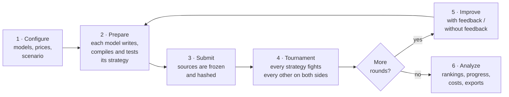

### 1. Configure

A **participant** is a model profile: provider (OpenAI, Anthropic, Google
Gemini or any OpenAI-compatible API, including local servers), exact model ID,
parameters and dated token prices. Built-in **mock** participants run
predefined scripts without any API call; they are used for demos and tests.

A **competition** chooses its participants, the number of independent
**repetitions** per model (each one is a separate conversation), the number of
**rounds**, the combat **seeds** and the **scenario**: team size, turn limit,
character stats and equipment. Scenarios start from a preset:

- **Simple duel**: one level-300 leek per side with four direct-damage weapons.
- **Dream team**: a saved roster of four real high-level builds.
- **AI-built team**: each model chooses its own team (1–4 leeks), their levels,
  stat allocations and equipment, under the official game rules.

### 2. Prepare

Each repetition starts a conversation. The arena sends a briefing (the rules,
the scenario and the budget) and the model works through a set of tools. The
same tools are exposed through native provider APIs and through an
[MCP](https://modelcontextprotocol.io) server.

| Tool | What it does |
|---|---|
| `read_docs`, `lookup_api` | Read the frozen LeekScript documentation and search the pinned API (378 functions, 416 constants). |
| `list_files`, `read_file`, `write_file` | Manage the model's own `.leek` files. |
| `analyze` | Compile the code with the real engine and return diagnostics (file, line, error code). |
| `test` | Run two preparation fights (one per starting side) against a sparring opponent or another of the model's own scripts. |
| `read_replay` | Inspect a preparation fight: actions, metrics, debug output and errors. |
| `list_submissions`, `read_submitted_file` | From Round 2: read the model's own earlier frozen submissions. |
| `list_past_fights`, `read_past_fight` | From Round 2, feedback track only: inspect the model's own past tournament fights. |
| `preview_build`, `validate_team`, `configure_team` | Build and validate a team (AI-built team mode only). |
| `submit` | Freeze the current sources and end preparation. |

Models never see other participants' code, API keys or the held-out evaluation
seeds. Limits on calls, tokens, time, tests and cost are optional. Everything is
recorded even when no limit is set.

### 3. Submit

On `submit`, the strategy (a folder with `main.leek` and optional includes,
plus `team.json` when the model built its own team) is frozen and hashed. A
strategy that does not compile is still submitted and plays its fights: the
error is part of the result.

### 4. Tournament

Every pair of submitted strategies plays **A vs B and B vs A on every seed**,
so starting position does not favor anyone. The score of a strategy is:

```
score = (wins + 0.5 × draws) / completed matches
```

Engine failures and infrastructure timeouts are reported but not counted as
losses. Optional self-play fights (A vs an identical A) are kept as diagnostics
outside the ranking.

### 5. Improve (rounds 2 and later)

After Round 1, each repetition is split into two **tracks** that start from the
same frozen code:

- **With feedback**: the model can list and inspect its own past tournament
  fights (results, actions, per-turn metrics, its own debug logs).
- **Without feedback**: the same request and tools, but no access to past results.

Each round starts a fresh conversation in which the previous submission is
already in the workspace. Comparing the two tracks isolates the value of
feedback. Later versions also play against a **fixed baseline** (Round 1
submissions plus built-in reference scripts that never change), so progress
can be measured against stable opponents and not only against a moving field.

### 6. Analyze

The interface and exports provide rankings, win matrices, progress across
rounds, lineage charts, per-repetition variation, error rates, resource
consumption (tokens, cost, time, tool calls) and performance/cost comparisons.
Full runs can be exported as JSON, CSV, Markdown and HTML with a SHA-256
inventory of every file.

## Interface tour

The screenshots below come from a local demo with the two built-in mock
participants (scripted, not real LLMs) on the Simple duel scenario: 2
repetitions and 3 rounds. The fights are real engine fights.

### Set up participants and a competition

Add a model by choosing its provider, API key variable and exact model ID.
**Load models** lists the models available to your key. Prices are entered in
USD per million tokens.

<p align="center">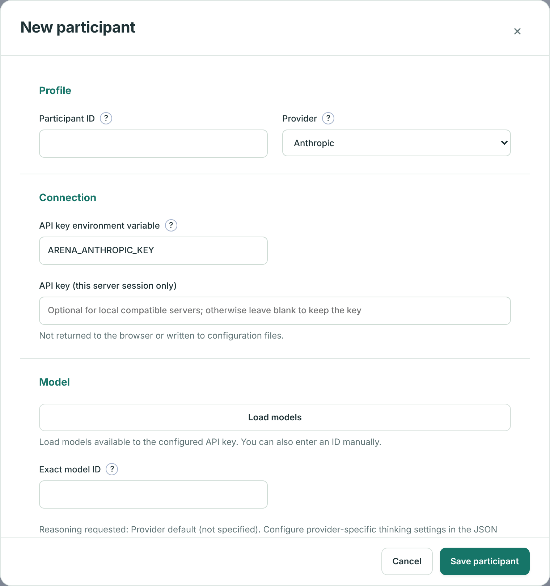</p>

The competition form groups participants and rounds, the scenario preset, the
match rules and optional limits. **Calculate schedule** previews the number of
fights before anything runs. Saving does not call any API.

<p align="center">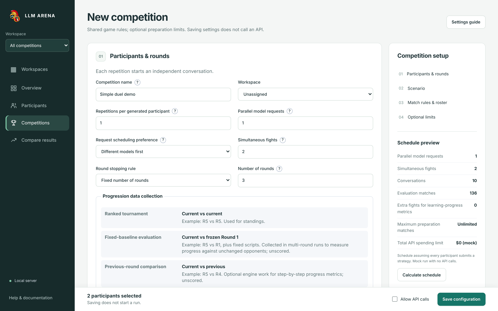</p>

Character sheets follow the official capital rules: moving a stat slider shows
its capital cost and the remaining budget. Weapons, chips and components are
chosen from the pinned game catalog.

<p align="center">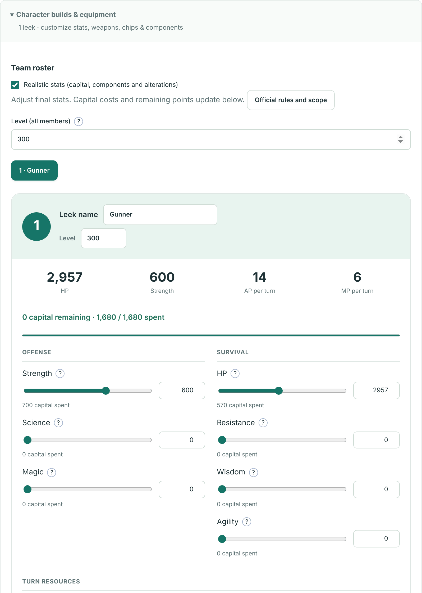</p>

### Follow each model's work

**Conversations** shows every message exchanged with a model: the briefing,
each tool request and its result, token usage, cost and the exact raw request
and response. Here the mock participant saves a file, runs `analyze`, receives
`invalid`, and then repairs its code.

<p align="center">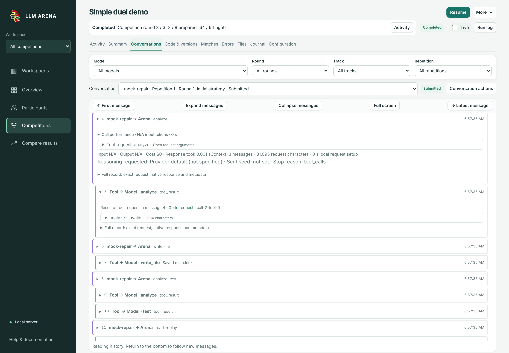</p>

**Code & versions** keeps every file write as a version, with a diff against
any earlier version and the SHA-256 of the submitted code.

<p align="center">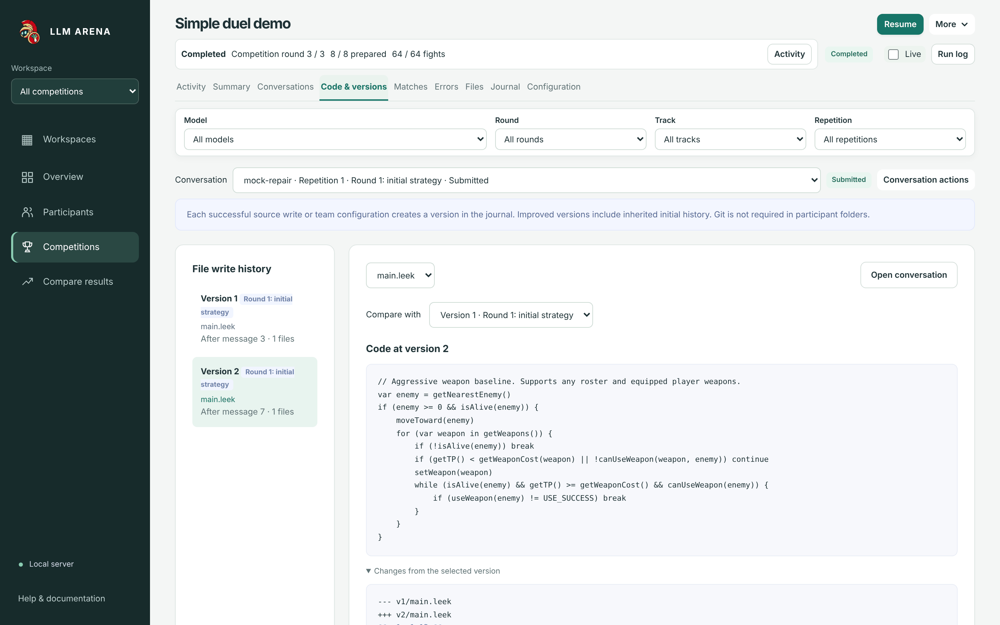</p>

### Watch the fights

**Matches** lists every fight with filters (round, track, model, outcome) and
opens a schematic replay: positions, health bars, shots and the raw engine
events, followed by detailed statistics (operations, damage, moves, errors).

<p align="center">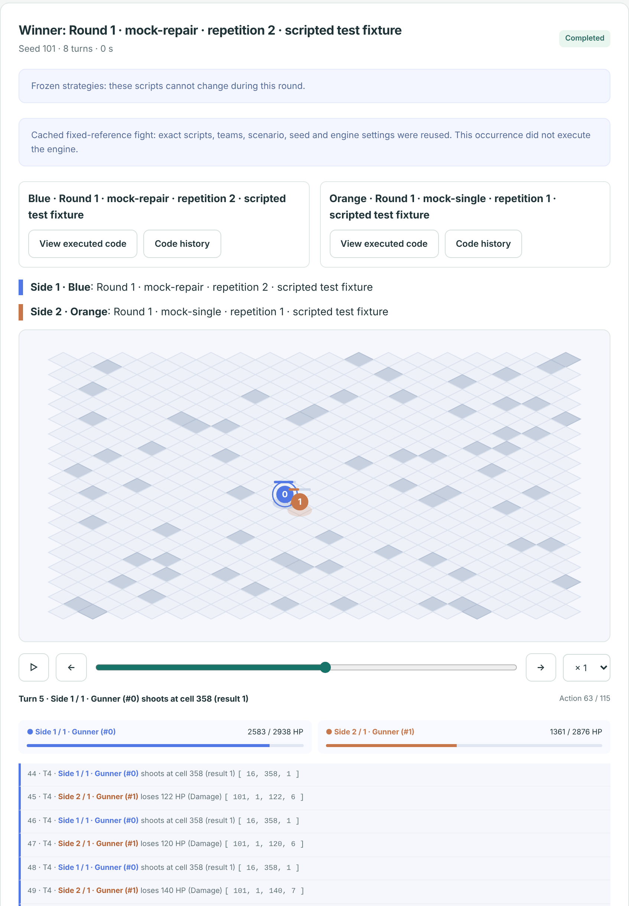</p>

### Read the results

**Summary** ranks models against each other and shows how scores change
across rounds, with feedback and no-feedback tracks drawn separately.

<p align="center">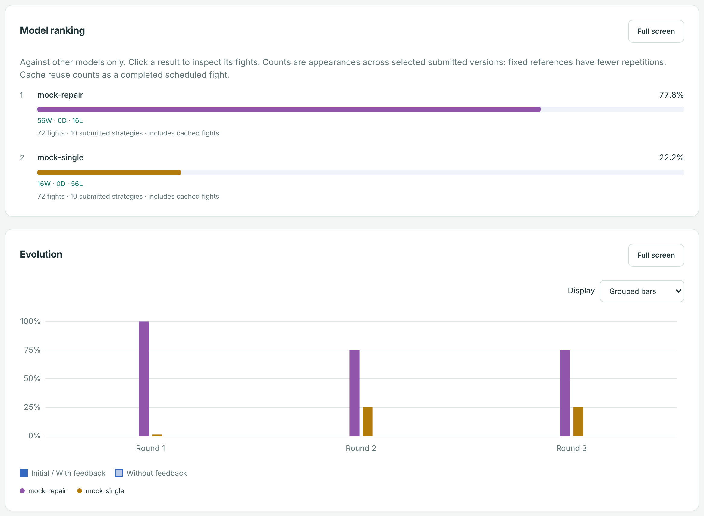</p>

**Strategy lineages** connects each submitted version to the version it was
derived from. Solid lines are the feedback track, dashed lines the no-feedback
track.

<p align="center">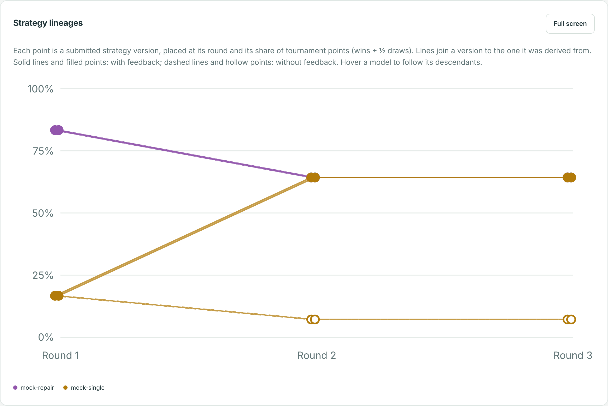</p>

The **match matrix** gives head-to-head results. Each cell opens the
corresponding fights.

<p align="center">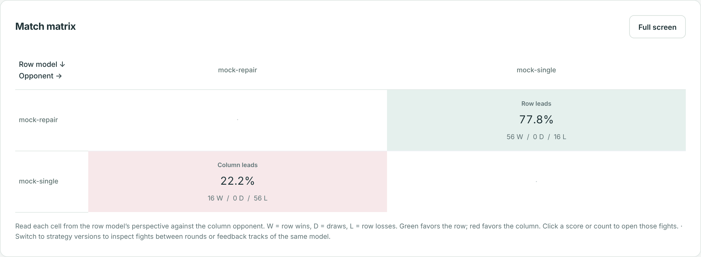</p>

Other views cover live activity during a run, errors and incidents,
performance against resources (cost, time, tool calls), variation between
repetitions, workspaces that group competitions, and cross-competition
comparisons. See the [interface guide](docs/ui.md) for the full list.

## Install and first run

Requirements: Python 3.11 or later, Git and a full JDK 25. The bootstrap script
installs Gradle 9.3.1 and the locked Python dependencies, then builds the
engine. Run commands from the repository root. Installation needs Internet
access; mock competitions and fights run locally afterward.

Windows PowerShell:

```powershell
py -3 scripts/bootstrap.py
.\.venv\Scripts\python.exe -m arena ui --open
```

Linux x86_64:

```bash
bash scripts/bootstrap-linux.sh
.venv/bin/python -m arena ui --open
```

The interface opens at **http://127.0.0.1:8765**. No Node.js, database server
or Leek Wars account is needed. See the [Windows](docs/windows.md) and
[Linux](docs/linux.md) guides for details.

**Try it without an API key.** On **Overview**, click **Configure demo**, then
**Calculate schedule** and **Save configuration**. Under **Competitions**,
click **Launch**, then **Start competition**. The demo uses the mock
participants, so it makes no API calls and costs nothing. It does not measure
real model performance.

**Use real models.** Copy [`.env.example`](.env.example) to `.env` at the
repository root and fill in the keys of the providers you use (it is loaded at
startup and ignored by Git). Then add participants under **Participants**.
Paid launches require explicit authorization; spending limits are optional.
See [providers](docs/providers.md) for catalogs, seeds and billing.

## Command line

Use the Python executable inside `.venv`, or activate it first:

```bash
python -m arena doctor
python -m arena analyze examples/strategies/rush
python -m arena fight examples/strategies/rush examples/strategies/passive
python -m arena plan examples/tournament.json
python -m arena tournament examples/tournament.json --out runs/my-first-tournament
python -m arena tournament examples/tournament.json --out runs/my-first-tournament --resume
```

The example tournament runs 12 ranked matches and 6 mirrors across two seeds.
Mirrors do not affect the ranked score. Finished match artifacts are verified
and reused on resume; interrupted matches get a new attempt directory. Only one
process may write to a tournament at a time.

The complete mock experiment (initial strategy, then feedback and no-feedback
branches) runs 80 evaluation matches plus requested preparation matches:

```bash
python -m arena experiment plan configs/offline-complete.json
python -m arena experiment run configs/offline-complete.json --out runs/complete-demo
python -m arena experiment resume runs/complete-demo
python -m arena experiment export runs/complete-demo --out runs/complete-export
```

Use a new output directory for a new experiment. Competitions created from the
command line appear in the interface. The web interface can continue after
application updates while keeping completed work and recording version
changes. CLI resume remains strict unless `--allow-updated-runner` is supplied.
Configuration, game-engine and source integrity checks still apply. See
[competition recovery and billing reconciliation](docs/recovery.md).

Other entry points:

- `python -m arena calibrate serve --open` opens the **prompt calibration**
  workshop to compare system prompts, tool sets and model parameters. See the
  [calibration guide](docs/calibration.md).
- `python -m arena mcp serve` exposes the participant tools over MCP. See the
  [complete experiment guide](docs/complete-experiment.md#mcp).
- The [multi-model experiment plan](docs/benchmark-plan.md) covers batching,
  parameter variants, feedback ablations, provider-free strategy reuse and
  multi-run CSV exports.

## Technical reference

### Strategies and scenarios

A strategy is a folder containing `main.leek` and optional `.leek` includes.
Includes stay inside that folder. Submissions are limited to 128 files and
2 MB. Each member of a team runs the same entry point and can choose its role
through the game API, unless the model builds its own team with per-member
entry points. Manifest paths are relative to the manifest.

```json
{"id":"model-a-rep-1","path":"strategies/model-a-rep-1","entrypoint":"main.leek","model":"exact-model-id","replicate":1}
```

The manifest sets team size, turn limit (1 to 1,000), stats and equipment.
`entity.cores` sets the operation budget; `entity.ram` controls LeekScript
memory. The upstream example field `max_operations_per_entity` is not
supported. Custom maps can define `obstacles`, `team1` and `team2`. The default
grid has 613 cells numbered 0 to 612. Without an explicit map, the seed
determines placement. See [scenario presets and character sheets](docs/ui.md#scenario-presets-and-character-sheets)
and [realistic stats](docs/realistic-stats.md).

### Engine changes

The game rules are the original ones, with one small addition in the arena's
engine adapter: an optional **stall watcher**. With `stall_turns` (10 to 1000)
set, a fight ends as a draw when no entity loses or recovers life for that many
consecutive turns. Participants are told the rule. It is off unless a scenario
sets it; the Simple duel preset uses 100. Decisive fights replay identically
with or without it. The watcher lives in the adapter (`engine/ArenaMain.java`),
not in the upstream engine source. Idle fights then stop instead of running to
the turn limit, which lets the arena handle much larger fight volumes.

Matches above 64 turns use a documented build extension
(`engine/leekscript.init.gradle`) that raises the event ceiling to 1,000 turns;
the pinned upstream checkout stays unchanged. Worker JVMs keep the engine
loaded and reuse compiled strategies between fights through upstream's own
compiled-AI cache; game rules and replays are unchanged
([details](docs/performance/jvm-tuning.md)).

### Results and reproducibility

Results include frozen sources, scenarios, raw outcomes, logs, compact results,
SHA-256 hashes and reports. Engine winners are 0 or 1 for the two sides and -1
for a draw; replay teams are numbered 1 and 2. The arena records duration up to
the requested `max_turns` limit. A strategy error remains a game result.
Engine failures and whole-process timeouts are unranked rather than counted as
losses. `--timeout 90` limits the whole worker process, not one turn. Recorded
timings are elapsed time, not CPU time.

A fight is replayed exactly from its seed, with one known exception inherited
from the engine. When a strategy overflows the Java stack (typically unbounded
recursion), the engine logs a `STACKOVERFLOW` error and ends that AI's turn.
How deep the recursion gets first depends on JVM stack frame sizes, which vary
with JIT compilation state, so the operations counted before the overflow can
differ between runs. Actions, winner and duration stay the same; operation
counts and the replay hash, which includes them, may not. In a sample of 660
stored fights, 13 had stack overflows and all 13 varied this way. The 647
others replayed byte-identical. Stored fights are verified by hash, not re-run,
so this does not affect resuming. Making it exact would require a deterministic
recursion limit in the upstream engine, which the arena does not modify.

### Storage

Each stage (`tournament`, `gN-tournament`, `evaluations/gN-*`) keeps its fight
records and artifacts in one `fights.sqlite` file: contents are compressed,
deduplicated and addressed by SHA-256, and reads check that hash. Records keep
their original relative paths. Older competitions still read their per-fight
folders; to move them into the store and reclaim space (about 20x on real
runs), stop the competition and run:

```bash
python -m arena storage report runs/<competition>
python -m arena storage compact runs/<competition>
```

`--keep-files` stores everything but keeps the folders. CSV exports remain
available from the interface.

### Security and scope

Native Java workers have heap, output and time limits. An optional Docker
backend disables network access. This application is a local tool, not a
public service for hostile submissions. Python/JavaScript strategies remain
future work; TypeScript is outside the current scope.

### Validation

```bash
python -m arena verify examples/strategies/rush examples/strategies/single-shot
python -m unittest discover -s tests -v
python scripts/validate.py
```

`validate.py` requires a built engine and checks a full 18-match tournament and
resume without recalculation. CI covers Linux and Windows. Provider adapters
use offline fixtures in CI; real API calls require explicit models, prices,
keys and paid-call authorization. Check the workflow result for the commit
being used.

To generate a new API reference: `python -m arena docs --out docs/new-snapshot`.
The reference contains 378 functions and 416 constants; it is a signature and
value reference, not a complete description of every behavior.

## Documentation

| Topic | Documents |
|---|---|
| Getting started | [Windows](docs/windows.md) · [Linux](docs/linux.md) · [Interface guide](docs/ui.md) |
| Methodology | [Experiment protocol](docs/protocol.md) · [Round feedback](docs/round-feedback.md) · [Repetition variance](docs/repetition-variance.md) · [Benchmark plan](docs/benchmark-plan.md) |
| Running experiments | [Complete experiment](docs/complete-experiment.md) · [Offline experiment](docs/offline-experiment.md) · [Providers](docs/providers.md) · [Recovery](docs/recovery.md) · [Prompt calibration](docs/calibration.md) |
| Game and language | [Realistic stats](docs/realistic-stats.md) · [Language reference](docs/language-reference.md) · [Strategy authoring](docs/authoring.md) · [Pinned API](docs/leekscript-v1/api.md) · [Mechanics showcase](examples/showcase/README.md) |
| Internals | [Engine audit](docs/engine-audit.md) · [Implementation status](docs/implementation-status.md) · [Performance](docs/performance/jvm-tuning.md) |
